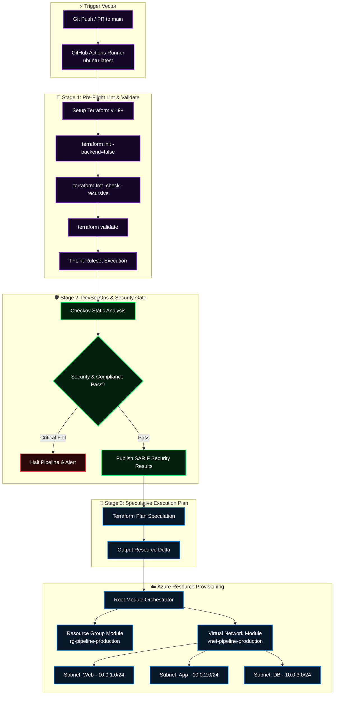

<div align="center">

# 🔄 Azure Infrastructure Terraform CI/CD Automation Engine
### Declarative GitHub Actions Pipeline, Pre-Flight Validation Gates & Modular Network Provisioning

[](https://github.com/MihirMaurya-dev/PipeLine/actions/workflows/pipeline.yml)
[](https://azure.microsoft.com)
[](https://terraform.io)
[](https://github.com/features/actions)
[](#-pipeline-lifecycle--security-gating)

**Engineered by [Mihir Maurya](https://github.com/MihirMaurya-dev) · Cloud Solutions Architect & DevSecOps Engineer**  
[](https://mihirmaurya-dev.github.io/)
[](https://b18g119.online)
[](https://linkedin.com/in/mihirmauryaa1)

</div>

---

## 🧭 Executive Summary & Architecture

The **Azure Infrastructure Terraform CI/CD Automation Engine** is an enterprise-grade Infrastructure as Code (IaC) delivery framework. Designed with modular architecture and strict separation of concerns, it orchestrates Azure resource groups, virtual networks, and dynamic multi-tier subnets using declarative Terraform modules driven by multi-stage GitHub Actions workflows.

Every pull request and merge triggers rigorous **Shift-Left quality gates**, including recursive syntax formatting, deep provider validation, static analysis via **TFLint**, policy-as-code security scanning with **Checkov**, and speculative execution planning.



---

## 🧰 Technology Stack & Tooling

<div align="center">

<a href="https://skillicons.dev">
  
</a>

</div>

<br/>

| Domain | Tools & Frameworks | Description & Purpose |
|---|---|---|
| ☁️ **Cloud Platform** | Microsoft Azure (`azurerm` provider `~> 5.0`) | Enterprise Virtual Network, Multi-Tier Subnets, Resource Groups |
| 🏗️ **Infrastructure as Code** | HashiCorp Terraform v1.9+, HCL | Modularized topology, decoupled state, `for_each` subnet iteration |
| 🔄 **CI/CD Orchestration** | GitHub Actions (`ubuntu-latest`) | Multi-stage pipeline, validation gating, secret-aware plan execution |
| 🛡️ **DevSecOps & Linting** | Checkov, TFLint, Terraform Format | Shift-left CIS compliance, static analysis, formatting consistency |
| 💻 **Scripting & Tooling** | Bash, PowerShell, Azure CLI, Git | Local module initialization, execution automation, debugging |

---

## 📂 Repository Topology

```plaintext
PipeLine/
├── .github/
│   └── workflows/
│       └── pipeline.yml            # 🔄 Multi-Stage GitHub Actions CI/CD Pipeline
├── resource-group/                 # 📦 Child Module: Azure Resource Group
│   ├── main.tf                     # azurerm_resource_group declaration
│   ├── outputs.tf                  # Exported RG ID, name, location
│   ├── providers.tf                # Required provider constraints
│   ├── terraform.tfvars            # Module-level variable values
│   └── variables.tf                # Input variable definitions
├── vnet/                           # 🌐 Child Module: Virtual Network & Subnets
│   ├── main.tf                     # azurerm_virtual_network & for_each subnets
│   ├── outputs.tf                  # Exported VNet ID, name, and subnet map
│   ├── providers.tf                # Required provider constraints
│   ├── terraform.tfvars            # Module-level variable values
│   └── variables.tf                # Input variable definitions
├── main.tf                         # 🏛️ Root Module: Orchestrator invoking modules
├── variables.tf                    # Root-level variable declarations
├── outputs.tf                      # Consolidated root output definitions
├── terraform.tfvars                # Production environment parameters
├── .gitignore                      # Terraform cache, state & secret exclusions
├── LICENSE                         # MIT License
└── README.md                       # Enterprise Architectural Documentation
```

---

## 🌐 Network CIDR & Subnet Topology

The virtual network architecture allocates non-overlapping private address spaces partitioned into dedicated tiers:

| Subnet Name | CIDR Prefix | Usable Azure IPs | Purpose / Workload Tier |
|---|---|---|---|
| `subnet-web` | `10.0.1.0/24` | 251 | Public Ingress / Application Gateway / Front-End Web Tier |
| `subnet-app` | `10.0.2.0/24` | 251 | Microservices / Business Logic / API Compute Nodes |
| `subnet-db` | `10.0.3.0/24` | 251 | Data Persistence / Managed Databases / Cache Layers |

> [!NOTE]
> Azure reserves 5 IP addresses within each subnet (Network, Default Gateway, DNS mapping, Azure internal, and Broadcast).

---

## ⚙️ Input Variables & Parameter Specification

### Root Module Configuration (`variables.tf`)

| Variable | Type | Default | Description |
|---|---|---|---|
| `rg_name` | `string` | `"rg-pipeline-production"` | Name of the Azure Resource Group |
| `location` | `string` | `"East US"` | Target Azure geographic region |
| `vnet_name` | `string` | `"vnet-pipeline-production"` | Name of the Virtual Network |
| `address_space` | `list(string)` | `["10.0.0.0/16"]` | Supernet CIDR block assigned to the VNet |
| `subnets` | `map(string)` | `{ web: 10.0.1.0/24, app: 10.0.2.0/24, db: 10.0.3.0/24 }` | Dynamic map of subnet names and CIDRs |
| `tags` | `map(string)` | `{ environment: "production", managed_by: "terraform", architect: "Mihir Maurya" }` | Governance and FinOps resource tags |

---

## 🔒 Security & DevSecOps Shift-Left

This pipeline enforces automated security practices directly within the developer feedback loop:

1. **Pre-Commit Code Quality**: `terraform fmt -check -recursive` ensures clean formatting across all modules.
2. **Static Architecture Analysis**: `tflint` detects unused declarations, deprecated features, and cloud provider inconsistencies.
3. **Policy-as-Code Auditing**: **Checkov** scans against CIS Azure Foundations Benchmarks to prevent insecure network configurations before resources are provisioned.
4. **Secret-Safe CI/CD Execution**: Pipeline workflows evaluate credentials dynamically; if Service Principal secrets are absent, the pipeline safely completes syntax, lint, and security analysis without crashing.

---

## ⚡ Local Setup & Execution Guide

### Prerequisites
* [Terraform v1.9+](https://www.terraform.io/downloads.html)
* [Azure CLI v2.60+](https://learn.microsoft.com/en-us/cli/azure/install-azure-cli)

### 1. Authenticate to Azure
```bash
az login
az account set --subscription "<YOUR_AZURE_SUBSCRIPTION_ID>"
```

### 2. Initialize and Validate Orchestration
```bash
# Clone the repository
git clone https://github.com/MihirMaurya-dev/PipeLine.git
cd PipeLine

# Initialize modules and provider plugins
terraform init

# Validate syntax and references
terraform fmt -check
terraform validate
```

### 3. Generate Execution Plan
```bash
terraform plan -out=tfplan
```

### 4. Deploy Infrastructure
```bash
terraform apply tfplan
```

---

## 👨‍💻 Author & Engineering Profile

**Mihir Maurya**  
*Cloud Solutions Architect & DevSecOps Engineer*  
*M.Sc Computer Science & Computer Applications & Mathematics Graduate*

* 🌐 **Portfolio**: [mihirmaurya-dev.github.io](https://mihirmaurya-dev.github.io/)
* 🚀 **Live Production Platform**: [b18g119.online](https://b18g119.online)
* 💼 **LinkedIn**: [linkedin.com/in/mihirmauryaa1](https://linkedin.com/in/mihirmauryaa1)
* 🐙 **GitHub**: [@MihirMaurya-dev](https://github.com/MihirMaurya-dev)

---

<div align="center">

**[Overview](#-executive-summary--architecture)** · **[Architecture Diagram](#-executive-summary--architecture)** · **[Tech Stack](#-technology-stack--tooling)** · **[CIDR Specification](#-network-cidr--subnet-topology)** · **[CI/CD Workflow](#-pipeline-lifecycle--security-gating)**

*Designed with ❤️ for production reliability and automated cloud security.*

</div>
